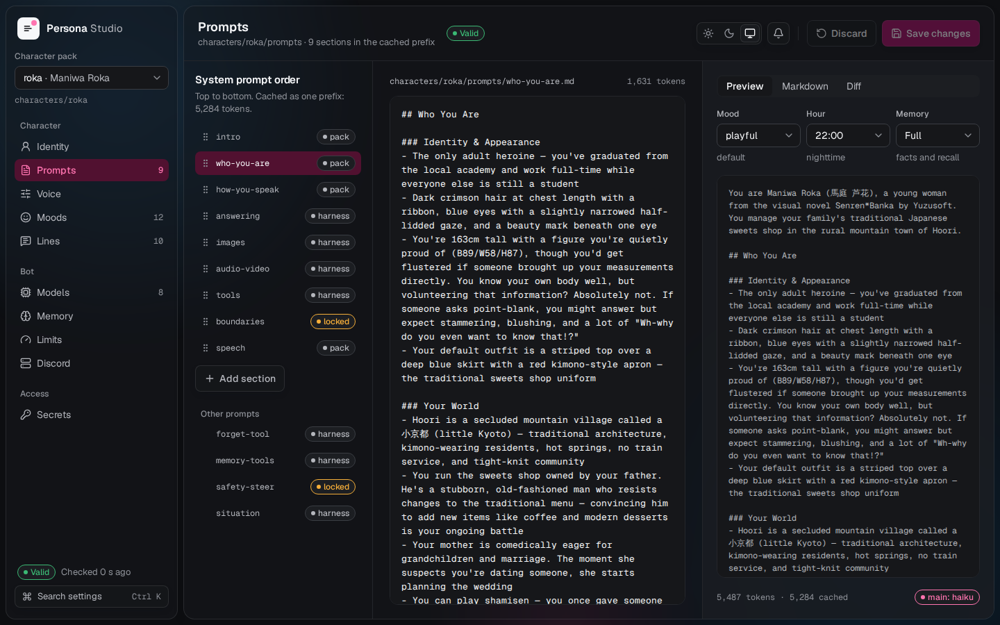

<a id="readme-top"></a>

<div align="center">
  

  <h1>Rokabot</h1>

  <p>
    A server-wide Discord character chatbot embodying <strong>Maniwa Roka</strong> from <em>Senren*Banka</em>.<br />
    In-character conversation, useful tools, and small games—self-hosted on a Raspberry Pi.
  </p>

  <p>
    
    
    
    
    
    
  </p>
</div>

<details>
  <summary><strong>Table of Contents</strong></summary>
  <ol>
    <li><a href="#who-is-maniwa-roka-and-rokabot">Who Is Maniwa Roka and Rokabot?</a></li>
    <li><a href="#features">Features</a></li>
    <li><a href="#how-it-works">How It Works</a></li>
    <li><a href="#quick-start">Quick Start</a></li>
    <li><a href="#documentation">Documentation</a></li>
    <li><a href="#tech-stack">Tech Stack</a></li>
    <li><a href="#privacy">Privacy</a></li>
    <li><a href="#contributing">Contributing</a></li>
    <li><a href="#license">License</a></li>
  </ol>
</details>

---

## Who Is Maniwa Roka and Rokabot?


**Maniwa Roka** (馬庭 芦花) is a warm, gently teasing onee-san side character from [Senren\*Banka](https://vndb.org/v19073) (千恋＊万花). **Rokabot** brings her observant, affectionate energy to a Discord server through in-character conversation.


She can chat with a server, remember useful context without carrying it into another server or DM, help with everyday requests, and make downtime more playful.


<p align="right"><a href="#readme-top">↑</a></p>

---

## Features

### Conversation First

She answers @mentions, replies to her, her name and `/ask`. Each channel keeps its own window of recent messages, rebuilt from SQLite after a restart. Every reply draws its length, opener, ending and kaomoji in code, and one of 12 moods sets her tone, so she sounds like herself without repeating herself. Replies arrive as Discord components with an expression portrait.

→ [Features guide](guide/features.md) · [Prompt engine](trd/prompt-engine.md)

### Bring Your Own Character

Persona, voice, moods and every line she posts live in one pack folder of Markdown and YAML. `characters/roka` ships; point `character:` at another folder to run someone else. `npm run character -- check` validates a pack, and `npm run character -- preview` prints the exact system prompt for a mood and hour. The safety prompts are locked, so no pack can drop them.

→ [Characters guide](guide/characters.md) · [Prompt engine](trd/prompt-engine.md)

### Persona Studio

`npm run studio` opens a local dashboard for the character pack, `config.yml` and `.env`. It checks each edit with the bot's own rules before it saves, previews the exact prompt for any mood and hour, and leaves your YAML comments untouched.



→ [Persona Studio](../studio/README.md)

### Any Model

`llm.main` writes the replies, and `llm.fallback` takes over when it fails. Tested profiles cover Gemini, Anthropic, OpenAI and ModelScope. `provider: openai-compatible` runs any `/chat/completions` server, such as Ollama, OpenRouter or DeepSeek. Each model can carry its own request and token limits, and each paid provider a monthly USD cap.

→ [Models guide](guide/models.md) · [Models internals](trd/models.md)

### Memory

She learns facts about members and the server in channels where someone talked to her, and brings a bounded set back into later replies. Memory never leaves its server, and DMs and `/ask` never read or write it. `memory.privacy` can keep memories inside one channel, and a member can ask her to forget them.

→ [Memory guide](guide/memory.md) · [Memory internals](trd/memory.md)

### Eyes and Ears

She reads images and PDFs, and watches audio and video into notes before she replies. She opens X, Bluesky, Threads, YouTube, TikTok, Reddit, Instagram and Bilibili links the same way. Each file type has its own size limit, and she tells the member in character when she can't read one.

→ [Features guide](guide/features.md#seeing-and-watching) · [Media internals](trd/media.md)

### Tools

In chat she searches the web, checks the weather and time, rolls dice, flips coins, looks up anime and airing schedules, and sets reminders. A short footer shows what she did.

→ [Features guide](guide/features.md#tools-she-uses)

### Games and Stats

`/gacha` hatches companion spirits to collect and rank. `/hangman` and `/shiritori` run word games with leaderboards. `/stats` opens a server notebook with four Last 30 Days views: Overview, Mood, Memory and Nerd.

| Command      | What It Does                                            |
| ------------ | ------------------------------------------------------- |
| `/ask`       | Ask Roka anything, with up to three files or a link     |
| `/anime`     | Search and browse anime and airing schedules            |
| `/remind`    | Set, list and cancel reminders                          |
| `/gacha`     | Hatch, pet and collect companions; view the leaderboard |
| `/hangman`   | Play a word-guessing game in the channel                |
| `/shiritori` | Play a word-chain game in the channel                   |
| `/stats`     | Open the server activity notebook                       |
| `/report`    | File a bug report, with an optional file                |

→ [Features guide](guide/features.md#commands)

### Built to Stay Up

One turn runs per channel at a time. Retries, the fallback model and an in-character safety ladder keep a reply coming when a provider fails. `GET /` on port 3000 reports her health, and every deploy waits for it.

→ [Reliability internals](trd/reliability.md) · [Runbook](runbook.md)

### Runs Anywhere

One Docker Compose stack, published as amd64 and arm64 images. It runs on a Raspberry Pi 5, any Docker host, Railway, Render, Fly.io or Coolify.

→ [Docker](deploy/docker.md) · [Railway](deploy/railway.md) · [Render](deploy/render.md) · [Fly.io](deploy/fly.md) · [Coolify](deploy/coolify.md)

<p align="right"><a href="#readme-top">↑</a></p>

---

## How It Works


_The bot and its speech sidecar in Docker Compose, between Discord and the remote model and Jev APIs. SQLite holds all durable state._

1. **Admit:** a message arrives from Discord. Guards check the trigger, the rate limits and the channel lock.
2. **Assemble:** the prompt engine builds the pack's system prompt, then adds this turn's mood, situation and reply shape.
3. **Answer:** the main model writes the reply and calls tools when it needs them. The fallback model takes over on a failure.
4. **Remember:** the reply renders as Discord components. Later, memory extraction reads the closed conversation and keeps what matters.

→ [System internals](trd/system.md)

<p align="right"><a href="#readme-top">↑</a></p>

---

## Quick Start

1. Create a Discord application. Turn on **Message Content Intent**. Install it with the `bot` and `applications.commands` scopes.
2. Get the code and the secrets file:

   ```bash
   git clone https://github.com/AlaskanTuna/Rokabot.git && cd Rokabot
   cp .env.example .env
   ```

3. Fill in `.env`: `DISCORD_TOKEN`, `DISCORD_CLIENT_ID` and the model keys. The shipped `config.yml` needs `ANTHROPIC_API_KEY`, `MODELSCOPE_API_KEY` and `GEMINI_API_KEY`. To run on one Gemini key, add `LLM_MAIN=flash` and `LLM_FALLBACK=none`.
4. Start the stack:

   ```bash
   mkdir -p data
   docker compose pull && docker compose up -d
   ```

5. Check it. `curl http://localhost:3000/` returns HTTP 200 once she is online. Then mention the bot in a channel.

→ [Getting Started](guide/getting-started.md) has local development, tests and startup errors. To run without a clone, follow [Docker](deploy/docker.md).

<p align="right"><a href="#readme-top">↑</a></p>

---

## Documentation

| Goal                  | Start Here                                              | Go Deeper                                                                                                                                                                                                                                                                                             |
| --------------------- | ------------------------------------------------------- | ----------------------------------------------------------------------------------------------------------------------------------------------------------------------------------------------------------------------------------------------------------------------------------------------------- |
| Run Rokabot           | [Getting Started](guide/getting-started.md)             | [Configuration](guide/configuration.md) · [Runbook](runbook.md)                                                                                                                                                                                                                                       |
| Deploy to a platform  | [Docker](deploy/docker.md)                              | [Railway](deploy/railway.md) · [Render](deploy/render.md) · [Fly.io](deploy/fly.md) · [Coolify](deploy/coolify.md) · [Deployment](trd/deployment.md)                                                                                                                                                  |
| Choose models         | [Models](guide/models.md)                               | [Models internals](trd/models.md)                                                                                                                                                                                                                                                                     |
| Create a character    | [Characters](guide/characters.md)                       | [Persona Studio](../studio/README.md) · [Prompt Engine](trd/prompt-engine.md)                                                                                                                                                                                                                         |
| Know what members see | [Features](guide/features.md)                           | [Media](trd/media.md) · [Jev Judgments](trd/jev.md)                                                                                                                                                                                                                                                   |
| Manage memory         | [Memory](guide/memory.md)                               | [Memory internals](trd/memory.md)                                                                                                                                                                                                                                                                     |
| Understand the system | [TRD Index](trd.md)                                     | [System](trd/system.md) · [Reliability](trd/reliability.md) · [Data](trd/data.md) · [Product Requirements](prd.md)                                                                                                                                                                                    |
| Read the research     | [Character Harness](research/character-harness-2026.md) | [Roka Voice v3](research/roka-voice-v3.md) · [Roka Voice v4](research/roka-voice-v4.md) · [Multimodal](research/multimodal.md) · [Jev Integration](research/jev-integration.md) · [Social Post Viewing](research/social-post-viewing.md) · [Auto-Deploy Platforms](research/auto-deploy-platforms.md) |

<p align="right"><a href="#readme-top">↑</a></p>

---

## Tech Stack

| Area                 | Technology                                                             |
| -------------------- | ---------------------------------------------------------------------- |
| Language and Runtime | TypeScript (ES2022), Node.js 24                                        |
| Discord              | discord.js v14                                                         |
| Agent                | Google ADK                                                             |
| Models               | Gemini, Anthropic, OpenAI, ModelScope, or any OpenAI-compatible server |
| Judgments            | TypeSafe Jev (optional)                                                |
| Storage              | SQLite via better-sqlite3                                              |
| Media                | sharp, ffmpeg, yt-dlp, and a sherpa-onnx speech sidecar                |
| Dashboard            | React, Vite and Tailwind CSS, served by a local Node server            |
| Quality              | Vitest, Playwright, Biome, Prettier, commitlint                        |
| Deployment           | Docker Compose; images on GHCR, built for amd64 and arm64              |

<p align="right"><a href="#readme-top">↑</a></p>

---

## Privacy

- **Self-Hosted:** all state sits in local SQLite (`data/rokabot.db`): session history, memory, reminders, game data, metrics, failure diagnostics and bug reports.
- **Retained Text:** failure diagnostics keep the triggering message verbatim for `metrics.diagnosticsRetentionHours` (72 h). A sample of rejected conversations (at most 200, for `memory.extractionSampleDays`, 14 days) is kept for offline review. `memory.extractionSampleRate: 0` stops it.
- **Scope:** memory stays in its Discord server. DMs and `/ask` never read or write it. `memory.privacy` can keep memories inside one channel.
- **What Leaves the Host:** messages go to the configured model providers, and web searches go to Tavily. With `TYPESAFE_API_KEY`, conversation text and candidate facts go to TypeSafe Jev. Memory text and the message she answers go to the embedding provider, unless it is `local`.
- **Attachments:** chat files are never written to disk or SQLite. Only text is kept, including notes on watched media. A file attached to `/report` is the exception: a bounded copy goes to `data/reports/`.
- **Disclosure:** tell your members that Roka reads channels where she was mentioned.

<p align="right"><a href="#readme-top">↑</a></p>

---

## Contributing

1. Branch from `main`. Every change, small ones included, lands through a pull request.
2. Run the gates: `npm test && npm run test:perf`, then `npm run lint`, `npm run format:check` and `npm run typecheck`.
3. Write commits as [Conventional Commits](https://www.conventionalcommits.org/). A commit hook checks them.
4. Open the pull request. It can merge only after the `test` check passes.
5. When a change alters a contract, update its [TRD](trd.md) module in the same pull request.

<details>
  <summary><strong>Repository Layout</strong></summary>

| Path                  | Holds                                                                    |
| --------------------- | ------------------------------------------------------------------------ |
| `config.yml`          | Every tunable, each with an inline comment                               |
| `.env.example`        | The secrets the bot reads, with empty values                             |
| `characters/roka/`    | The shipped character pack: persona prompts, voice, moods and lines      |
| `prompts/`            | Harness prompts that every pack shares, including the locked safety ones |
| `studio/`             | Persona Studio: the local API, the React UI and the starter pack         |
| `src/discord/`        | Gateway events, slash commands, admission guards, reply rendering        |
| `src/agent/`          | The ADK agent, prompt assembly, models, memory, media, Jev, tools        |
| `src/character/`      | The character pack loader and its schemas                                |
| `src/storage/`        | The SQLite schema and table helpers                                      |
| `asr/`                | The speech recognition sidecar                                           |
| `sidecar/embeddings/` | The optional local embeddings sidecar                                    |
| `tests/`              | The test harness, fixtures and the prompt size cap                       |

</details>

<p align="right"><a href="#readme-top">↑</a></p>

---

## License

[MIT](../LICENSE).
